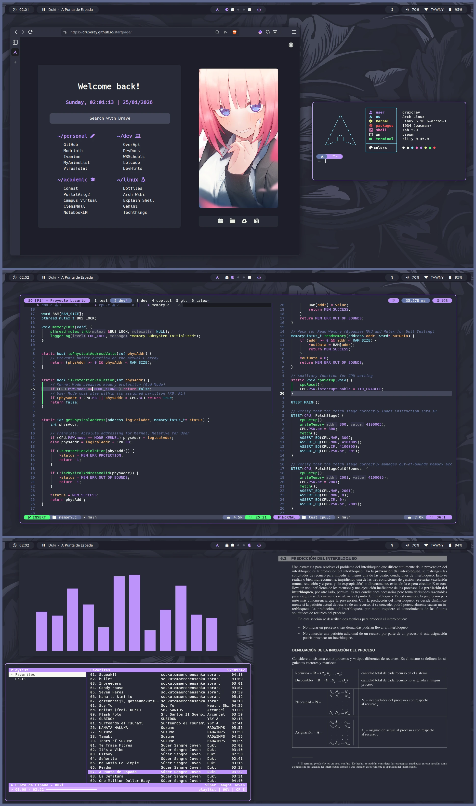

<h1 align="center">Dotfiles</h1>

<div align="center">

_A minimalist repository of my dotfiles for Arch Linux_

[](https://github.com/druxorey/dotfiles/stargazers)
[](https://github.com/druxorey/dotfiles)
[](https://visitorbadge.io/status?path=https%3A%2F%2Fgithub.com%2Fdruxorey%2Fdotfiles)
[](https://github.com/druxorey/dotfiles/blob/main/LICENSE)

</div>

## About

This repository contains the configuration files, scripts, and themes that make up my daily computing environment. The core of this setup is built on **Arch Linux** and **BSPWM**, an extremely fast and minimal tiling window manager, controlled entirely via keybindings with **SXHKD**, allowing a highly productive, keyboard-driven workflow.

The entire aesthetic of this rice is unified by the **Dracula** color palette for the dark theme and **Alucard** for its light variant, ensuring a consistent and elegant look across all applications.

## Showcase

Here is a glimpse of how the desktop looks in action. More screenshots showcasing different tools and workflows will be added here in the future.



## Installation

Everything is installed with [`drxdots`](drxdots), a single Bash script that updates the system, installs the packages (from Pacman and the AUR), deploys the dotfiles, enables the services and configures ZSH.

### Quick start

Run the interactive wizard without saving the script:

```bash
bash <(curl -fsSL https://druxorey.me/dotfiles/drxdots)
```

Or install a flavour without any prompt:

```bash
bash <(curl -fsSL https://druxorey.me/dotfiles/drxdots) install bspwm
```

### Flavours

| Flavour   | Installs                       | What it is                                     |
| --------- | ------------------------------ | ---------------------------------------------- |
| `core`    | `core`                         | Terminal only (servers, VMs without GUI)       |
| `minimal` | `core` + `minimal`             | Terminal plus lightweight graphical essentials |
| `bspwm`   | `core` + `minimal` + `bspwm`   | X11 BSPWM, Polybar, Rofi...                    |
| `kde`     | `core` + `minimal` + `kde`     | Wayland KDE Plasma desktop                     |
| `mangowm` | `core` + `minimal` + `mangow`  | Wayland MangoWM window manager                 |

For every flavour, in this order, `drxdots` runs its `<flavour>-install.sh`, which:

1. Installs its package list (`<flavour>.packages`) with `yay`, installing `yay` first if it is missing.
2. Deploys its dotfiles (see [Repository structure](#repository-structure)).
3. Applies anything specific modification to that flavour.
4. Enables its systemd services (`<flavour>.services`).

> [!WARNING]
> Deploying **overwrites** any existing file with the same name in your `~/.config`, `~/.local`, home directory and your user crontab. Back up your own configuration before installing on a machine you already use.

### Interactive wizard

Running `drxdots` without arguments opens a `dialog` interface that asks, in order:

1. **CachyOS repositories** (only on vanilla Arch): adds the optimized CachyOS repositories using the official CachyOS script. It also replaces `pacman` with the CachyOS fork.
2. **Extra kernels**: `linux`, `linux-lts`, `linux-zen`, `linux-hardened` and, on CachyOS, its own kernels. The matching headers are installed too.
3. **Flavour:** the list is built from the `flavours/` folder.
4. **NFS / SMB shares**: add mount points by placing them at `/mnt/<name>` through `/etc/fstab`.
5. **Git identity and SSH key**: sets your name, email and signing key in `~/.gitconfig` and can generate an `ed25519` SSH key if you do not have one.

The unattended `install <FLAVOUR>` mode skips all of this: it installs the flavour with the defaults configurations and nothing else.

## Repository structure

```text
dotfiles/
├── drxdots           The script wizard, installation and backup
├── cmd/              Small single-purpose tools that drxdots calls
├── core/             The base flavour
├── flavours/         The other flavours: minimal, bspwm, kde, mangowm
├── utils/            My personal scripts, installed to ~/.local/bin by core
└── assets/           Repository screenshots
```

Every flavour has the same layout:

```text
flavours/bspwm/
├── bspwm-install.sh      What to run to install this flavour
├── bspwm.packages        Packages to install (one per line, # for comments)
├── bspwm.services        systemd services to enable
├── bspwm.yaml            Which files `drxdots backup` copies into this flavour
├── config/               Deployed to ~/.config
├── home/                 Deployed to ~
├── local/                Deployed to ~/.local
└── extras/
    ├── etc/              Deployed to /etc (with sudo)
    └── var/spool/cron/   Installed as your user crontab
```

### The tools in `cmd/`

Each tool can be run on its own. Use `-h` on any of them to see its options.

| Tool                     | What it does                                                                           |
| ------------------------ | -------------------------------------------------------------------------------------- |
| `ensure-yay.sh`          | Installs `yay` if it is missing                                                        |
| `add-cachy-repos.sh`     | Adds the CachyOS repositories to vanilla Arch                                          |
| `install-packages.sh`    | Installs the packages listed in one or more `.packages` files                          |
| `deploy-configs.sh`      | Copies `config/`, `home/`, `local/` and `extras/` of a flavour to the system           |
| `deploy-utils.sh`        | Installs the scripts in `utils/` into `~/.local/bin`                                   |
| `setup-zsh.sh`           | Sets `ZDOTDIR`, installs the ZSH plugins and makes ZSH your default shell              |
| `enable-services.sh`     | Enables (and starts) the services listed in `.services` files                          |
| `configure-fstab-nas.sh` | Adds NFS/SMB shares to `/etc/fstab`, keeping its credentials in a root-only file        |
| `configure-git-ssh.sh`   | Sets your Git identity in `~/.gitconfig` and generate an SSH key                   |
| `backup-dotfiles.sh`     | Copies your current system configuration into this repository                                  |

## Backing up your changes

`drxdots backup` copies your current system configuration back into the repository, so the repository always reflects your real setup:

```bash
./drxdots backup -d          # dry run: show what would change, modify nothing
./drxdots backup             # copy everything
./drxdots backup -f bspwm    # force a flavour instead of auto-detecting it
```

It decides what to copy from the `core/core.yaml`, `flavours/minimal/minimal.yaml` and `<flavour>.yaml` files. Each one lists the paths to back up; a path ending in `/` is a directory, and `exclude` skips what you do not want:

```yaml
name: core
routes:
  - source: ~/.config/nvim/
    exclude:
      - "*.log"
  - source: ~/.zshrc
```

The flavour is detected from your desktop session (KDE, Cinnamon, BSPWM or MangoWM) unless you force it with `-f`. Besides the files, the backup also adds new packages from `~/.local/share/packages.list` (Linking with my package manager [drxpkg](https://github.com/druxorey/drxpkg)) to the package lists, saves your `~/.local/bin` into `utils/`, converts the Brave bookmarks to YAML and blanks out your Git name, email and signing key in `core/home/.gitconfig` before anything is committed. It needs `rsync`, and `drxdots` installs it for you if it is missing.

If you run it from outside the repository, it clones the repository into `./dotfiles` and backs up there. In both cases the changes are only written to the files: review, commit and push them yourself.

## License

This project is licensed under the GPL-3.0 License. See the [LICENSE](LICENSE) file for more details.
